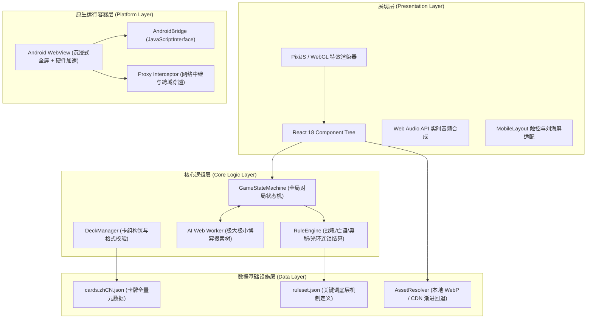
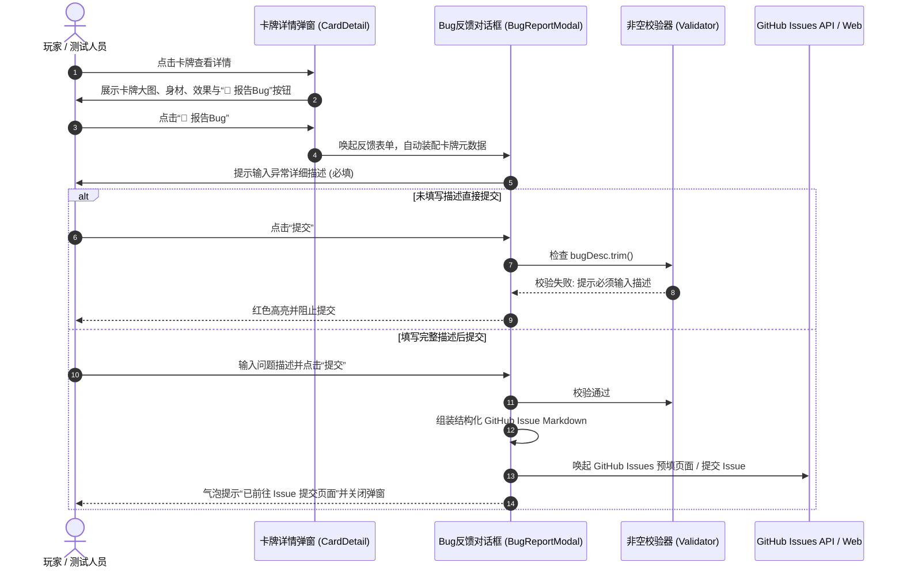

# 《炉石传说单机版》（Hearthstone Offline）核心架构设计文档

本文档深入剖析《炉石传说单机版》的前后端分层架构、对战规则引擎、AI 智能决策树、资源装载管道以及本次新增的卡牌缺陷反馈系统。

---

## 1. 整体架构设计分层



---

## 2. 核心模块详解

### 2.1 对战状态机与规则结算系统 (Battle Engine & RuleEngine)
- **状态流转**：
  游戏遵循严格的炉石时间线规则：`Mulligan(调度抽牌) -> TurnStart(回合开始抽牌与法力恢复) -> ActionPhase(出牌/攻击/技能/回合结束) -> TurnEnd(回合结束触发器) -> GameOver`。
- **连锁结算堆栈 (Trigger Pipeline)**：
  当一张卡牌打出时，系统按顺序触发：
  1. `OnPlayEvent`（扣除水晶、触发战吼目标选择）；
  2. `BattlecryPhase`（执行战吼逻辑，支持多次触发如铜须）；
  3. `SecretPhase`（奥秘响应窗口，如爆炸符文、法术反制）；
  4. `DeathProcessing`（阵亡检测，入墓地，触发亡语队列）；
  5. `AuraRecalculation`（全场随从光环身材实时动态刷新）。

### 2.2 独立 Web Worker AI 决策引擎 (AI Worker)
- **计算隔离**：
  AI 逻辑置于独立的 Web Worker (`web/assets/ai.worker.js`) 中运行，完全与主线程 UI 渲染解耦，保证复杂计算时不出现任何掉帧或 UI 卡死。
- **启发式评估模型**：
  - **场面权重 (Board Advantage)**：随从攻击力、生命值、圣盾/嘲讽/剧毒溢价。
  - **手牌优势 (Card Advantage)**：手牌数量、高费斩杀线潜力。
  - **节奏模拟 (Tempo & Face Damage)**：敌方英雄剩余血量评估，智能切换解场模式与走脸抢血模式。

### 2.3 原画与资产装载管道 (Asset Resolution Pipeline & HSO.zip Loader)
- **多层级离线资产检索链路**：
  1. **层级 1 (APK 内置 Assets)**：`assetManager.open(decodedPath)`。若为全量打包 APK，则直接以 0 延迟由系统底层装配。
  2. **层级 2 (外部扩展美术包 HSO.zip)**：若 APK 内部未内置原画（轻量版 APK，体积仅约 25MB），原生容器启动时自动检索手机公共存储（优先 `/sdcard/Download/HSO.zip`）及应用私有目录。
     - 底层基于 `java.util.zip.ZipFile` 实现常驻中心目录哈希检索，O(1) 索引命中，支持在 WebResourceResponse 中以流式（Stream）零拷贝直接注入 WebView，无额外内存消耗，免去庞大的解压过程。
  3. **层级 3 (CDN 渐进回退)**：若本地与外部扩展包均未命中，系统容错降级回退至 `assets/card-back.svg`（经典卡背），并在联网状态下由前端从 HearthstoneJSON CDN 动态补齐。
- **安全与权限策略**：
  - AndroidManifest 配置了 `READ_EXTERNAL_STORAGE`、`MANAGE_EXTERNAL_STORAGE` 与 `android:requestLegacyExternalStorage="true"`，全面向下兼容 Android 7.0 至 Android 14+。
  - 在 `web/index.html` 的 CSP 策略中白名单放行相关协议。

---

## 3. 卡牌 Bug 反馈系统设计 (Bug Reporting Subsystem)

### 3.1 业务流程设计



### 3.2 提交载荷示例 (Issue Payload Specification)
提交至 GitHub Issue 的内容采用结构化 Markdown：
```markdown
### 缺陷卡牌信息
- **卡牌名称**: 神奇的威兹班
- **卡牌编号**: BOT_914
- **职业**: 中立
- **费用**: 8
- **品质**: 传说
- **系列**: 砰砰计划
- **卡牌效果**: 对战开始时：你的套牌被替换为威兹班的一套奇妙套牌。

### Bug 描述
在选择恶魔猎手职业时，威兹班生成的卡组偶发只有28张牌，且英雄技能未正常替换。

---
*提交环境: 炉石传说单机版客户端 / 卡牌详情内置反馈*
```
