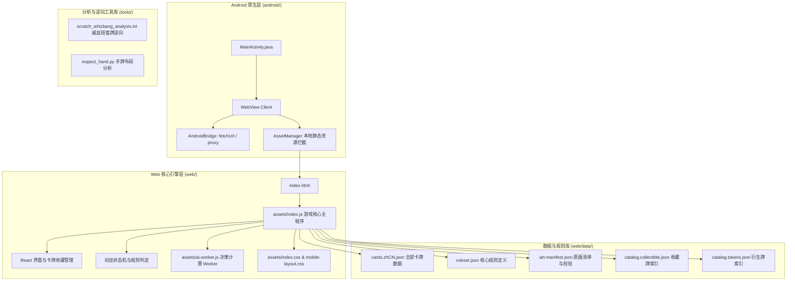

# 《炉石传说单机版》（Hearthstone Offline）代码与资产全景盘点

本文件对项目解构后的所有模块、核心代码、数据资产以及反编译辅助工具进行详细盘点与功能梳理。

---

## 1. 项目整体架构全景

本项目基于 **现代化 Web 技术栈（React + TypeScript + Vite + PixiJS）** 与 **Android WebView 原生外壳** 构建，完整实现了《炉石传说》标准对战、酒馆战棋、卡牌收藏管理、智能 AI 对战及卡组构筑系统。

---

## 2. 代码模块明细盘点

### 2.1 Android 原生外壳层 (`android/`)

| 文件路径 | 语言 | 核心职责 | 关键实现细节 |
| :--- | :--- | :--- | :--- |
| `android/app/src/main/AndroidManifest.xml` | XML | Android 清单配置 | 设定全屏传感器横屏 (`sensorLandscape`)、全面屏/刘海屏适配 (`notch.config`, `maxAspectRatio=2.6`)、网络与音频权限 |
| `android/app/src/main/java/com/hearthstone/offline/MainActivity.java` | Java | 主 Activity 与 WebView 容器 | 1. 隐藏系统导航栏和状态栏（沉浸式全屏） 2. 开启硬件加速、WebStorage、IndexedDB 3. 注入 `AndroidBridge` JavaScript 接口 4. 拦截 `http://localhost/*` 映射至本地 assets 5. 拦截 `/api/proxy` 实现跨域代理 |
| `android/build.gradle` & `app/build.gradle` | Groovy | Android 构建脚本 | 标准 Gradle 构建配置，目标 SDK 34，最低 SDK 24 (Android 7.0+) |
| `android/app/src/main/res/` | PNG/XML | 应用程序图标与绘制资源 | 各分辨率启动图标 (`ic_launcher.png`) |

---

### 2.2 Web 核心代码层 (`web/assets/`)

| 文件名称 | 格式/大小 | 核心功能与模块划分 |
| :--- | :--- | :--- |
| `index.js` (`index-CU9H2UDJ.js`) | JS (~22.5 MB) | **游戏主执行体**： 1. **UI 渲染**：主菜单、旅店对战大厅、我的收藏 (Collection)、开包模拟、卡组编辑器、酒馆战棋等界面。 2. **卡牌详情与操作**：原画展示、金卡切换、合成/分解、属性系列展示，**本次新增内置「🐞 报告Bug」与提交 GitHub Issue 功能**。 3. **规则引擎**：随从出场、法术结算、奥秘挂载与触发、亡语队列、疲劳机制、光环效果计算。 4. **对战状态机**：回合阶段管理、法力水晶扣除/过载、攻击目标选择与阻挡判定。 |
| `ai.worker.js` (`ai.worker-Yhf24pzo.js`) | JS (~20.0 MB) | **独立 Web Worker AI 决策计算器**： 采用 Minimax 极大极小搜索与启发式评估函数，模拟多步出牌、攻击与技能释放的最优序列，避免阻塞主线程动画与渲染。 |
| `mobile-layout.js` | JS (~50 KB) | **移动端/触摸屏自适应控制器**： 动态计算视口宽高比 (Viewport Scale)，针对不同刘海屏与宽高比自动添加安全区域边距 (SafeArea Padding)，处理触摸拖拽手牌防误触。 |
| `index.css` (`index-CTplPp4x.css`) | CSS (~172 KB) | **游戏全套主题样式表**： 复刻暴雪炉石传说木质羊皮纸酒馆质感风格、卡牌边框、金色流光、水晶槽、抽牌对局战场布局。 |
| `mobile-layout.css` | CSS (~46 KB) | **移动端专用响应式适配样式**： 针对手机竖屏/宽屏的卡牌尺寸缩放比例与弹性布局。 |
| `card-back.svg` / `tavern-icon.*` | SVG/PNG | 卡背矢量图与旅店图标资源。 |

---

### 2.3 数据与规则库盘点 (`web/data/`)

| 文件名 | 大小 | 内容与结构描述 |
| :--- | :--- | :--- |
| `cards.zhCN.json` | 10.0 MB | **全量中文卡牌数据库**：包含经典、狂野、标准各扩展包全部随从、法术、武器、英雄牌，含 cardClass, cost, attack, health, text, rarity, mechanics 等数十个字段。 |
| `catalog.collectible.json` | 2.37 MB | **可收集卡牌索引目录**：过滤衍生卡，仅保留玩家可在卡牌收藏库中构筑和拥有的卡牌清单。 |
| `catalog.tokens.json` | 5.98 MB | **衍生卡牌与首领专用牌目录**：收录如衍生的青玉魔像、巫妖王死亡骑士牌、零件牌、动物伙伴等。 |
| `ruleset.json` | 478 KB | **炉石基础机制与关键词规则表**：战吼 (BATTLECRY)、亡语 (DEATHRATTLE)、圣盾 (DIVINE_SHIELD)、风怒 (WINDFURY)、剧毒 (POISONOUS)、潜行 (STEALTH)、嘲讽 (TAUNT) 等关键词核心逻辑参数。 |
| `art-manifest.json` | 3.66 MB | **原画资源清单**：记录各卡牌编号对应的 WebP 原画哈希值与存在性校验。 |
| `coverage.json` | 227 KB | **机制实现覆盖率报告**：记录当前代码对全量卡牌特殊效果实现的覆盖状态与兼容度。 |
| `integrity.json` | 2.85 MB | **数据完整性校验表**：防止数据文件在离线环境中被意外损坏。 |
| `manifest.json` | 444 B | 扩展包版本与版本号定义。 |

---

### 2.4 分析与逆向工程辅助工具 (`tools/`)

| 文件名 | 描述 |
| :--- | :--- |
| `inspect_hand.py` | 手牌 CSS 类选择器分析脚本，用于分析对战界面中 hand-area 与 hand-card 样式匹配。 |
| `scratch_whizbang_analysis.txt` | 《神奇的威兹班》(BOT_914) 机制逆向分析笔记，解析随机套牌生成的条件与卡池。 |
| `scratch_whizbang_func.txt` | 威兹班套牌组装函数的反混淆源码还原。 |
| `scratch_toy_decks.json` | 威兹班预设经典卡组列表。 |
| `scratch_opp_deck.txt` | AI 对手卡组构筑与抽牌逻辑逆向笔记。 |
| `scratch_bc_func.txt` / `scratch_jl_func.txt` | 战吼及法术结算链式调用的底层中间态函数提取。 |

---

## 3. 本次新增功能：卡牌详情“报告Bug”功能盘点

### 3.1 界面交互逻辑
1. **触发入口**：在卡牌收藏大厅点击任意卡牌进入「卡牌详情」弹窗。卡牌基本信息（名称、编号、费用、系列、品质、效果说明）下方新增「🐞 报告Bug」专用按钮。
2. **必填校验约束**：点击「报告Bug」唤起反馈对话框。对话框中强制要求输入异常描述：
   - 若用户未输入描述直接点击「提交」，系统触发本地非空校验警告（`必须进行 Bug 描述才能提交！`），并高亮提示输入框。
3. **数据封装与格式化**：
   - 自动提取当前卡牌的元数据：卡牌名称、卡牌编号（如 `BOT_914`）、职业、费用、稀有度、所属系列、效果文本。
   - 结合用户输入的异常描述，结构化为标准 GitHub Issue Markdown 模版。
4. **提交至 GitHub Issue**：
   - 自动生成符合 GitHub 标准的提交 URL：`https://github.com/LayerLwb/HearthstoneOffline/issues/new?title=...&body=...`
   - 一键唤起浏览器打开新建 Issue 页面，卡牌信息与问题描述已全自动填充完毕，同时支持自动复制至剪贴板，方便跨设备粘贴。
